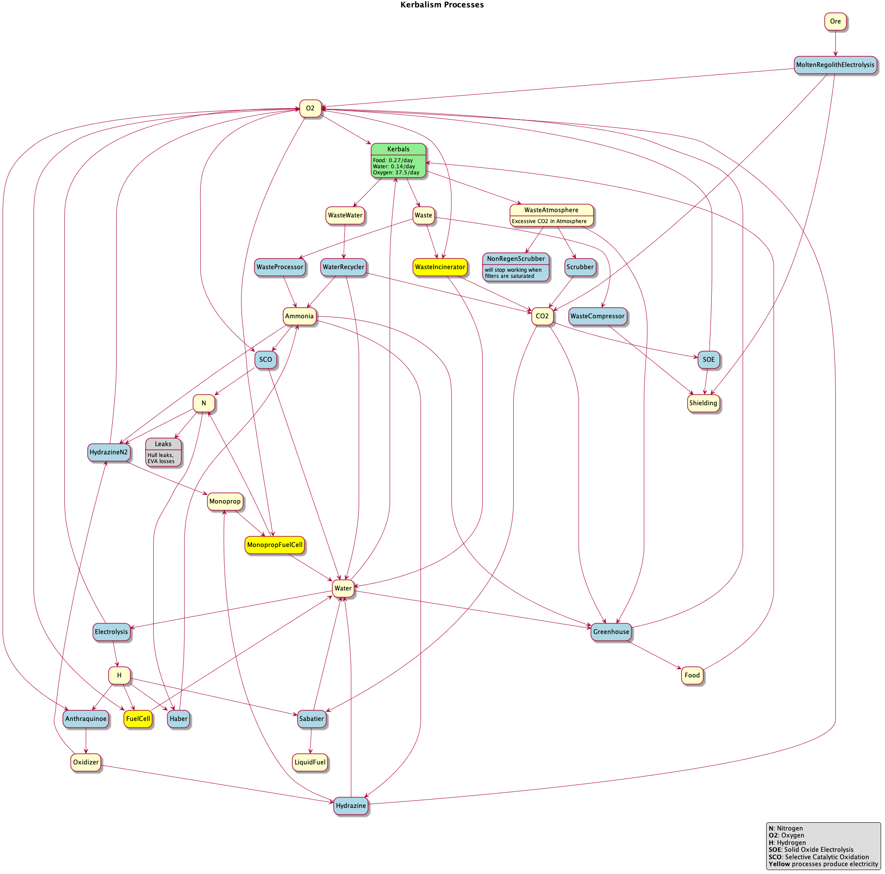
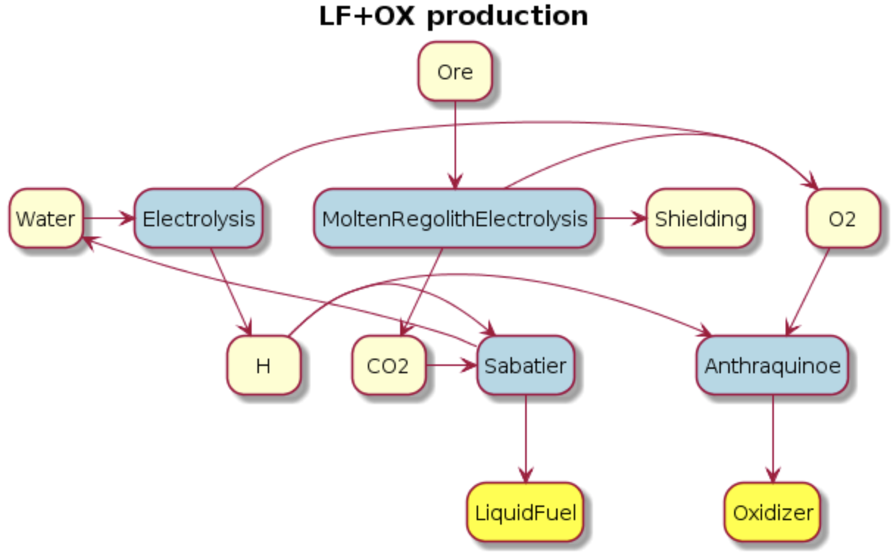

## Overview

There are many processes available in Kerbalism, and you can do any number of things with them. This chart will help you navigate the various processes and resources.

## Containers
The containers are configurable in the VAB. The inline supply containers can store.

- Food and Water *(Supplies)*
- Food
- Water
- Waste and WasteWater *(Sewage)*
- Waste
- WasteWater

The radial pressurized containers can store.

- Oxygen gas
- Nitrogen gas
- Hydrogen gas
- Ammonia gas
- CarbonDioxide gas
- Xenon gas

## ISRU
Configurable ISRU's can execute a set of available chemical processes that can be configured in the VAB. Processes will stop running if they don't have the available resources or if there is no capacity for the output resources to go into. Excess resources can be dumped overboard by using the Dump function in order to enable a process to keep running if output capacity is not available.

LiquidFuel, Oxidizer and MonoPropellant chemical components regarding the processes are.

- LiquidFuel = Methane *CH4*
- Oxidizer = HydrogenPeroxide *H2O2*
- MonoPropellant = Hydrazine *N2H4*

| CHEMICAL PROCESS | INPUT RESOURCES | OUTPUT RESOURCES | TECH REQUIRED |
| --- | --- | --- | --- |
| Water electrolysis | EC, Water | Hydrogen, Oxygen |  |
| Sabatier process | EC, CO2, Hydrogen | Water, LiquidFuel |  |
| Haber process | EC, Nitrogen, Hydrogen | Ammonia |  |
| Waste incinerator | Waste, Oxygen | CO2, Water, EC | Precision Engineering |
| Waste compressor | EC, Waste | Shielding | Precision Engineering |
| Anthraquinone process | Hydrogen, Oxygen | Oxidizer | Advanced Science |
| Hydrazine production | EC, Ammonia, Oxidizer | Water, O2, Monoprop | Advanced Science |
| Hydrazine production N2 inj | EC, Ammonia, Oxidizer, Nitrogen | O2, Monoprop | Experimental Science |
| Solid oxide electrolysis | EC, CO2 | Oxygen, Shielding | Experimental Science |
| Molten regolith electrolysis | EC, Ore [Regolith] | Oxygen, CO2, Shielding | Experimental Science |
| Selective catalytic oxidation | EC, Ammonia, Oxygen | Nitrogen, Water | Experimental Science |

## Harvesters
Crustal, Oceanic and Atmospheric harvesters can be configured to extract one among a set of resources.

| HARVESTER | RESOURCE |
| --- | --- |
| Crustal | Water |
| Crustal | Ore |
| Crustal | Nitrogen |
| Oceanic | Water |
| Oceanic | Nitrogen |
| Oceanic | Ammonia |
| Atmospheric | CarbonDioxide |
| Atmospheric | Oxygen |
| Atmospheric | Nitrogen |
| Atmospheric | Ammonia |

## Fuel cells
Fuel cells can be configured to use a number of resources to produce *ElectricCharge*. They operate under the same conditions as the chemical processes on the ISRU's

| CELL TYPE | INPUT RESOURCE | EXTRA OUTPUT |
| --- | --- | --- |
| H2+O2 | Hydrogen and Oxygen | Water |
| Monoprop+O2 | MonoPropellant and Oxygen | Water and Nitrogen |

## Cryogenic processes

With CryoTanks installed, chemical plants can liquefy or vaporize hydrogen and methane. Phase changes conserve mass: 1 unit of liquid hydrogen corresponds to about 788.10 units of Hydrogen, and 1 unit of liquid methane to about 593.60 units of Methane, using the CRP resource definitions. Both directions consume ElectricCharge. The phase-change processes receive the same engineer bonus as electrolysis and methanation.

CO2 Methanation and the legacy SE-RWGS process directly produce LqdMethane and Water. Their power demand includes methane liquefaction, so existing liquid-methane production chains do not need another process slot. The separate methane liquefier and vaporizer are optional. Gas buffers provided by the phase-change setups start empty.

The LH2 Oxygen Fuel Cell consumes liquid hydrogen and gaseous Oxygen. It produces the same power and Water as the gas-hydrogen fuel cell on the same part. Liquid hydrogen changes the storage requirements, not the fuel cell's power rating. The default profile uses Oxidizer as a peroxide proxy; it is not interchangeable with the Oxygen consumed by these fuel cells.

The Algae Bioreactor remains available for existing craft. Its simplified carbohydrate model conserves mass across CarbonDioxide, WasteWater, Food, Oxygen and Water. At capacity 1 it supplies one Kerbal's base Food demand, before the engineer bonus, and consumes 1.8 EC/s for lighting and pumps.

USI FTT uses the same hydrogen conversion and fuel-cell rates. Installing both mods adds one set of selectable hydrogen processes. Existing process names and liquid-methane connections are retained, but vessels relying on the former excessive fuel-cell output or incorrect resource yields will need rebalancing. These configurations do not constitute a complete thermodynamic or SystemHeat model.

## Mining stations

You will need two things to produce Liquid Fuel and Oxidizer on a mining station: CO2 and Hydrogen. CO2 can be extracted from ore or from the atmosphere, if it has any in it (hint: Duna does). Hydrogen can be gained from Water that you have to find somewhere.

